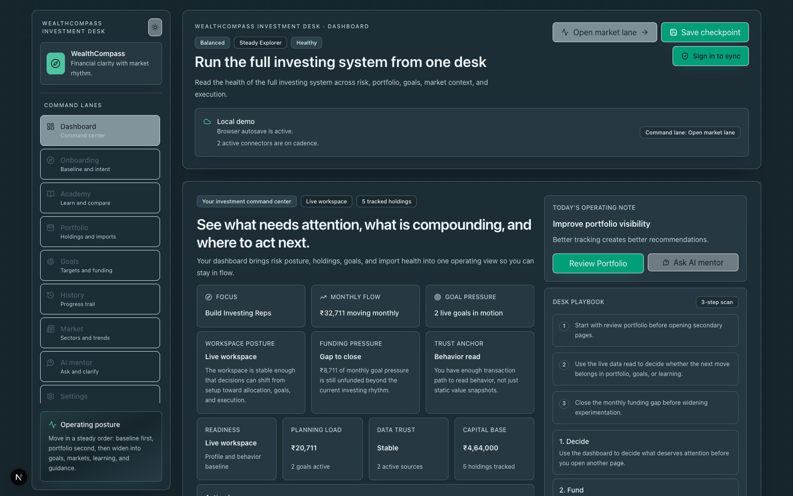
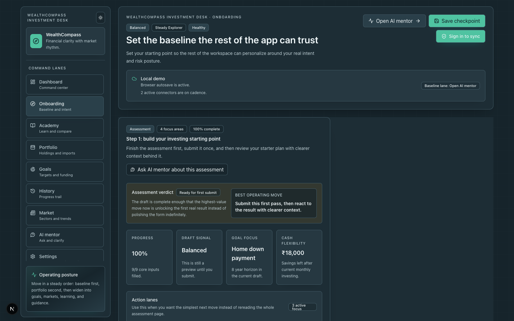
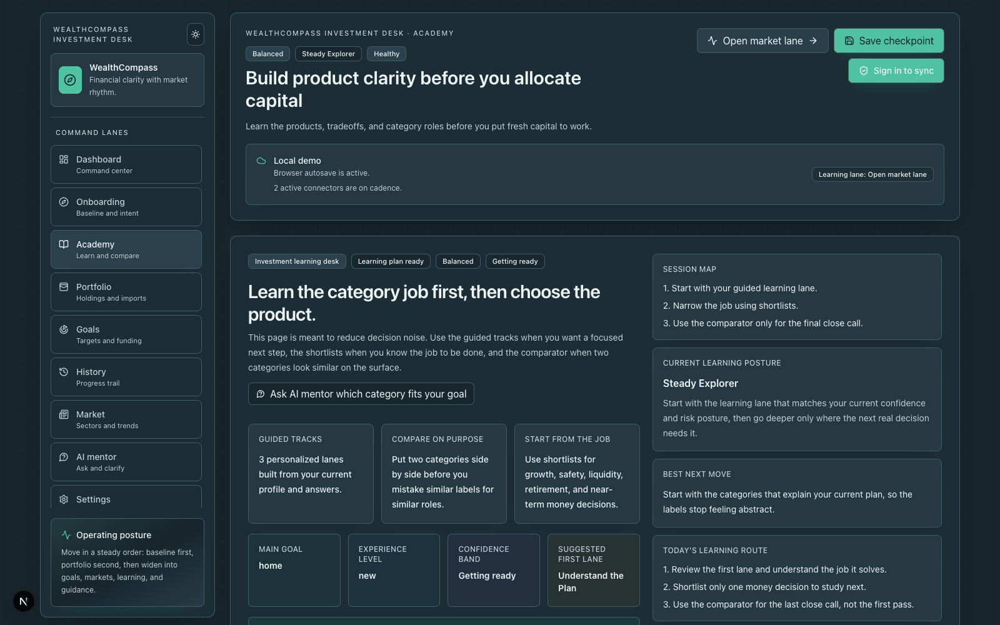
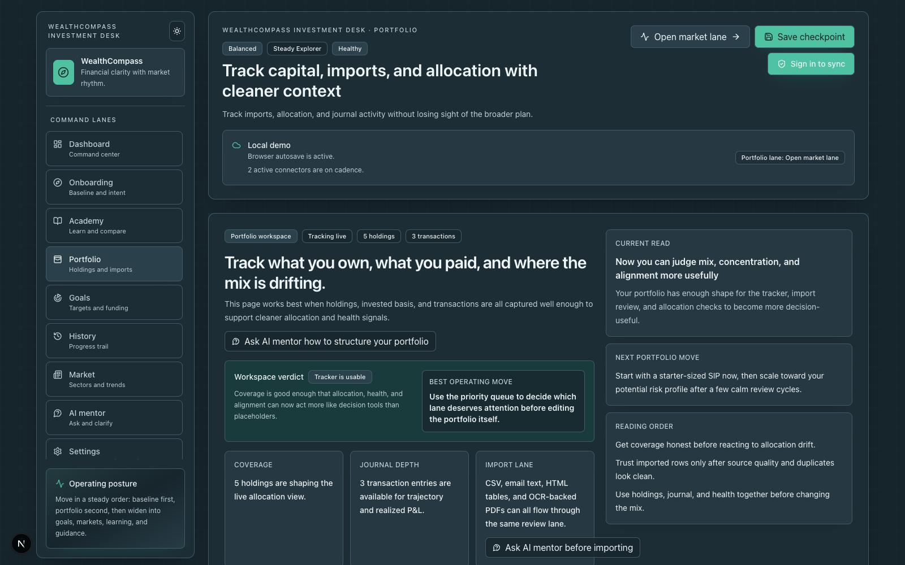
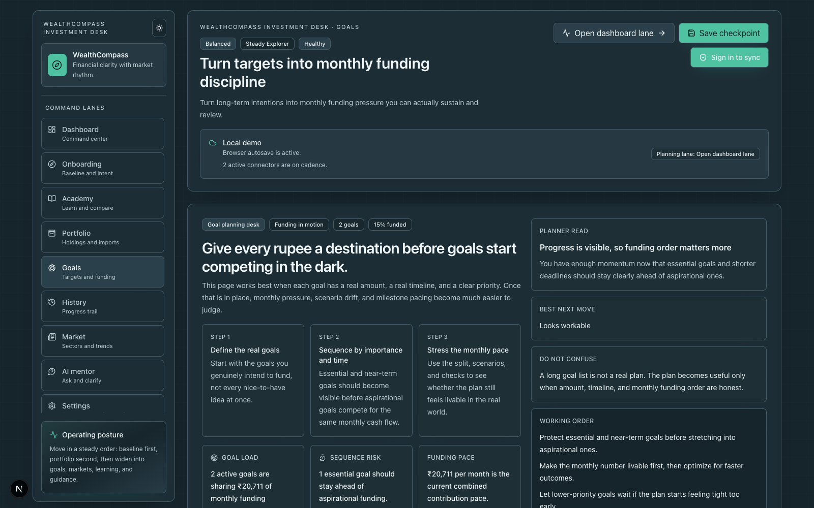
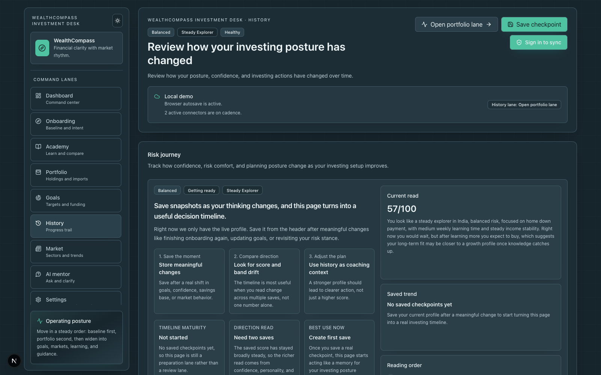
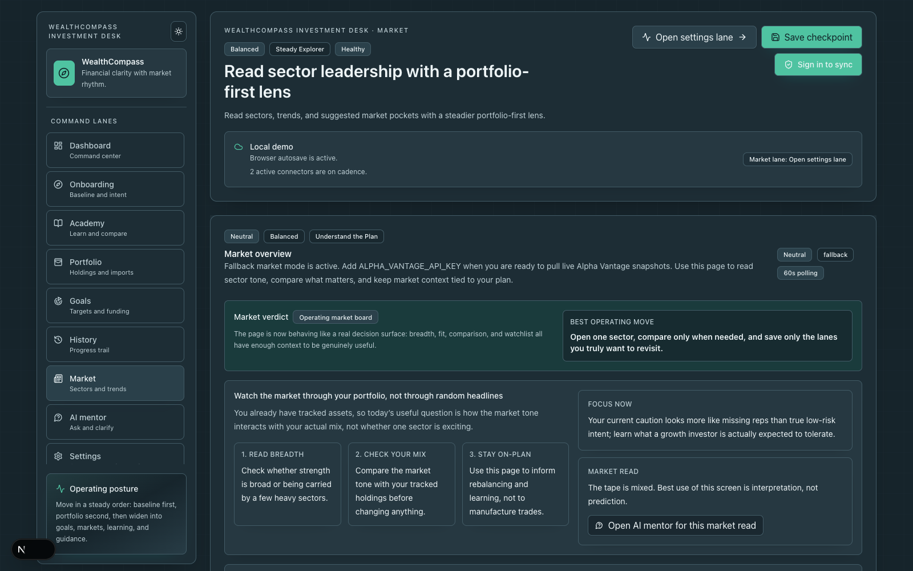
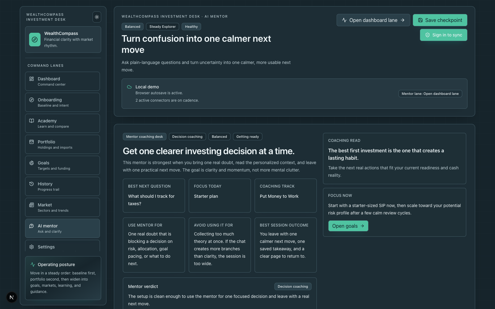
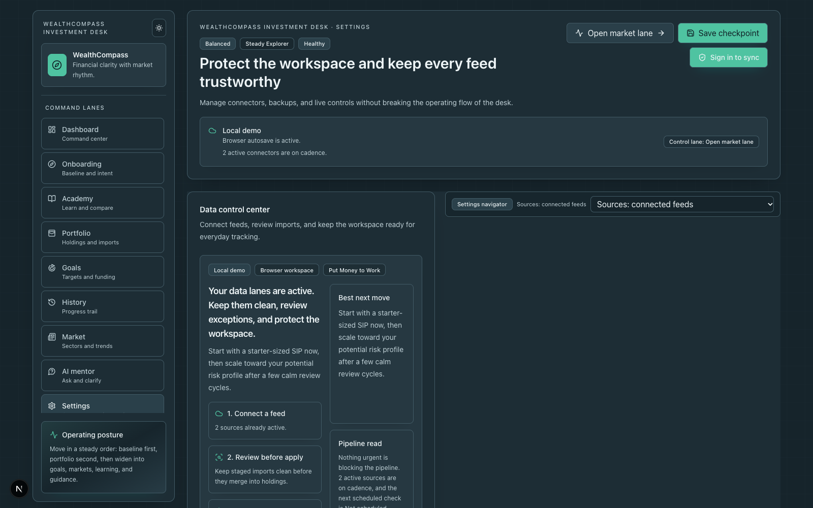

# WealthCompass product screenshots

These captures document the local demo workspace at a 1600 × 1000 desktop viewport. They use the included demo data and do not expose personal financial information.

## Command center and investor baseline

| Dashboard | Onboarding |
| --- | --- |
|  |  |

## Learning, portfolio, and planning

| Academy | Portfolio |
| --- | --- |
|  |  |

| Goals | History |
| --- | --- |
|  |  |

## Context, guidance, and control

| Market | AI mentor |
| --- | --- |
|  |  |

| Settings and data controls |
| --- |
|  |
